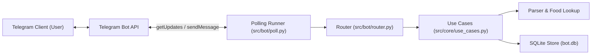

# Operations Runbook: Telegram Calorie Tracker Bot

| Field | Value |
|---|---|
| **Document** | Operations Runbook (`docs/operations/runbook.md`) |
| **Owner** | Khumoyun (Operations & Evidence Co-Lead) |
| **Backup** | Mazen (Operations & Evidence Lead) |
| **Reviewer** | Mazen (Operations & Evidence Lead) |
| **Last updated** | 2026-11-23 |
| **Target Release** | `a6-final-release` (to be created at the freeze) |
| **Operating Mode** | Local Polling Daemon (`src.bot.poll`) |

---

## 1. System Overview & Operational Architecture

The Team 4 Telegram Calorie Tracker bot is designed as a modular, layered system:
- **Presentation / Adapter Layer:** In the final release, interaction with the Telegram Bot API runs via the **local polling runner** (`src/bot/poll.py`), which calls `getUpdates`.
- **Why Polling in Release:** The production design is a webhook (`src/bot/web.py`, ADR-0005). However, deploying a public HTTPS webhook requires cloud hosting verification checks (`V-2` to `V-4` on PythonAnywhere), which are deferred. The polling runner executes the exact same application router (`src/bot/router.py`) and core use cases as the webhook, providing identical behavior without exposing a public endpoint (CC-3).
- **Core Domain:** Message parsing (`src/core/parser.py`), calorie calculation (`src/core/day.py`), and food resolution (`src/core/food_lookup.py`).
- **Persistence Layer:** Standard library `sqlite3` (`src/adapters/store.py`). Data is stored in a local SQLite file (`bot.db`).



---

## 2. Prerequisites & Environment Setup

### 2.1 Software Requirements
- **Python 3.12+** (governed by ADR-0009). Verify using:
  ```bash
  python3 --version
  ```
- **Git** (for version control).

### 2.2 Environment Configuration (`.env`)
The bot loads environment variables via `load_dotenv()` in `src/bot/poll.py`. Create a `.env` file in the project root directory:

```bash
# Telegram Bot Configuration (replace with your test token from BotFather)
TELEGRAM_BOT_TOKEN="123456:REPLACE_ME"

# Optional: Custom SQLite Database Path (defaults to "bot.db" if omitted)
BOT_DB_PATH="bot.db"
```

> [!CAUTION]
> **Secret Hygiene (NFR-3, Risk 6):** Never commit `.env` or any file containing a live Telegram token to the repository. The `.gitignore` file explicitly ignores `.env` and `*.db`.

---

## 3. Starting, Stopping, and Verifying the Bot

### 3.1 Starting the Polling Daemon
From the repository root, start the bot with:

```bash
python3 -m src.bot.poll
```

### 3.2 Expected Startup Logs
Upon launch, `poll.py` initializes the Telegram client, opens SQLite, and prints the exact console message:

```text
INFO poll Bot started. Message your test bot in Telegram. Press Ctrl+C to stop.
```

### 3.3 Verifying Bot Operation
1. Open Telegram and search for your bot's handle (registered via `@BotFather`).
2. Send `/start`.  
   **Expected Reply (3 lines):**  
   ```text
   Welcome to the Team 4 calorie tracker test.
   Send one food per message, for example: 2 eggs
   Calories come from a small sample list during this test.
   ```
3. Send a test food: `2 eggs`.  
   **Expected Reply:**  
   `"Logged 2 x Egg (1 large egg each) = 140 kcal. Today's total: 140 kcal."`

### 3.4 Stopping the Daemon
To terminate the bot cleanly, issue an interrupt signal:
- In terminal: Press `Ctrl + C` (SIGINT).
- The process outputs `INFO poll Stopped.` and terminates cleanly.

---

## 4. Database Operations & Maintenance

The bot uses SQLite (`bot.db`) managed exclusively by `src/adapters/store.py` (contract C-6).

### 4.1 Schema Overview
The database initializes the following tables automatically upon first connection:
- `users`: Tracks registered Telegram users (`telegram_user_id`, `created_at_utc`).
- `entries`: Records logged meal items (`id`, `telegram_user_id`, `food_text`, `matched_description`, `quantity`, `unit`, `kcal`, `source`, `logged_at_utc`).
- *(If PR #104 is merged)* `processed_updates`: Tracks Telegram `update_id` for duplicate protection (T-30).

### 4.2 Inspecting the Database Safely
To inspect database records without modifying data:

```bash
# Check registered user count
sqlite3 bot.db "SELECT count(*) AS total_users FROM users;"

# View recent logged entries (shows isolated tester data)
sqlite3 bot.db "SELECT id, telegram_user_id, food_text, kcal, logged_at_utc FROM entries ORDER BY id DESC LIMIT 5;"

# Verify database file integrity
sqlite3 bot.db "PRAGMA integrity_check;"
```

### 4.3 Automated Backup Procedure (Task T-35)
Per Architecture §8, SQLite backups must use SQLite's online backup API to prevent copying during an active transaction:

```bash
# Execute a consistent online snapshot
sqlite3 bot.db ".backup 'bot_backup_$(date +%Y%m%d_%H%M%S).db'"
```

### 4.4 Restoring from Backup
If the database file is corrupted or entries are damaged:
1. Stop the polling process (`Ctrl + C`).
2. Move the damaged database file aside:
   ```bash
   mv bot.db bot_corrupted_$(date +%Y%m%d).db
   ```
3. Copy the latest valid snapshot into place:
   ```bash
   cp bot_backup_YYYYMMDD_HHMMSS.db bot.db
   ```
4. Restart the bot (`python3 -m src.bot.poll`).

---

## 5. Troubleshooting & Incident Response

| Symptom / Failure | Root Cause | Operator Action |
|---|---|---|
| `TelegramConfigError: TELEGRAM_BOT_TOKEN environment variable is not set` | Missing or unreadable `.env` file. | Verify `.env` exists in the repository root and contains `TELEGRAM_BOT_TOKEN="123456:REPLACE_ME"`. |
| `Conflict: can't use getUpdates method while webhook is active` | A previous webhook URL was set on the bot token via Telegram API. | Run the following command to delete the registered webhook: <br>`curl -s "https://api.telegram.org/bot123456:REPLACE_ME/deleteWebhook"` |
| Console logs `Lookup failure: food item not found in database` | Tester entered a food item not present in `src/core/sample_foods.json`. | Expected behavior. No operator action required. Note: failure logging is sanitized and omits user ID and food text (NFR-3, NFR-4). |
| Tester receives `"Something went wrong. Please try again later."` | An unexpected exception occurred during update routing. | The bot's crash-protection handler caught the error without terminating the daemon (PR #96). Check the console traceback for details. |
| `sqlite3.OperationalError: database is locked` | Concurrent process access or hanging file lock. | Ensure only one instance of `src.bot.poll` is running (`ps aux \| grep poll.py`). Close any external SQLite CLI sessions or locks. |

---

## 6. Safe Logging & Data Privacy Guarantees

In compliance with **NFR-3** (Credential Security) and **NFR-4** (Minimum Data Retention):
1. **Zero Secret Leakage:** Bot tokens are never printed in console logs, error traces, or test outputs.
2. **Zero PII in Logs:** When a user enters an unparseable or unrecognized food, `src/core/food_lookup.py` logs a generic category string (`Lookup failure: food item not found in database`), intentionally omitting the user's Telegram ID and the raw food query text.
3. **Tester Data Separation (AC-7.1):** All database queries are scoped by `telegram_user_id`. One user can never read, modify, or sum another user's calorie entries.
4. **Security & Quality Audits:** For credential scanning and security checklists, see `docs/security/security-checklist.md` and the CI secrets scanner in `.github/workflows/ci.yml`. For known defects, see `docs/quality/defect-summary.md`.
