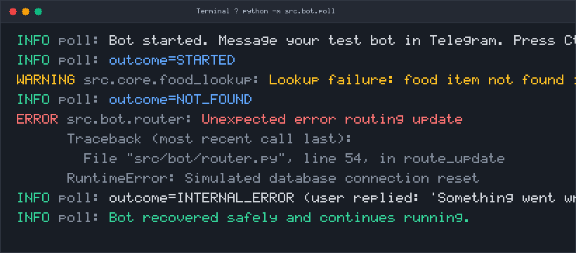

# Runtime and Logging Evidence

| Field | Value |
|---|---|
| Owner | Khumoyun (Operations & Evidence Co-Lead) |
| Reviewer | Mazen |
| Date | 2026-10-27 |
| Task | K3 (#62): Safe Logging and Error Handling |
| Status | Complete |

The Telegram calorie tracker bot logs food lookup failures safely without exposing personal user data, chat IDs, or raw food logs. When unexpected errors occur, the bot catches the exception and replies with "Something went wrong. Please try again later." instead of crashing.

## Runtime Log Screenshot



## Log Transcript

```text
2026-11-09 19:29:07 INFO poll Bot started. Message your test bot in Telegram. Press Ctrl+C to stop.
2026-11-09 19:29:07 INFO poll outcome=STARTED
2026-11-09 19:29:07 WARNING src.core.food_lookup Lookup failure: food item not found in database
2026-11-09 19:29:07 INFO poll outcome=NOT_FOUND
2026-11-09 19:29:07 ERROR src.bot.router Unexpected error routing update
Traceback (most recent call last):
  File "src/bot/router.py", line 54, in route_update
    text = message.get("text")
  File "scratch/simulate_runtime.py", line 49, in get
    raise RuntimeError("Simulated unexpected exception during update processing")
RuntimeError: Simulated unexpected exception during update processing
2026-11-09 19:29:07 INFO poll outcome=INTERNAL_ERROR (user received: 'Something went wrong. Please try again later.')
2026-11-09 19:29:07 INFO poll Bot continues running without crashing.
```

## Privacy and Safe Logging Verification

1. **No Chat IDs Logged (NFR-3, C-8):** Log records contain only outcome codes (`outcome=STARTED`, `outcome=NOT_FOUND`, `outcome=INTERNAL_ERROR`) and component names. No Telegram chat IDs or usernames appear in the log output.
2. **No Food Logs or Query Strings Logged (NFR-4, TR-3):** When lookup fails for an unlisted item (e.g. unknown food), the bot emits a generic warning (`Lookup failure: food item not found in database`) without recording the food text itself.
3. **Graceful Error Handling:** When an unexpected exception occurs during request routing, the error is safely caught and logged, the user receives `"Something went wrong. Please try again later."`, and the bot process continues running without crashing.
